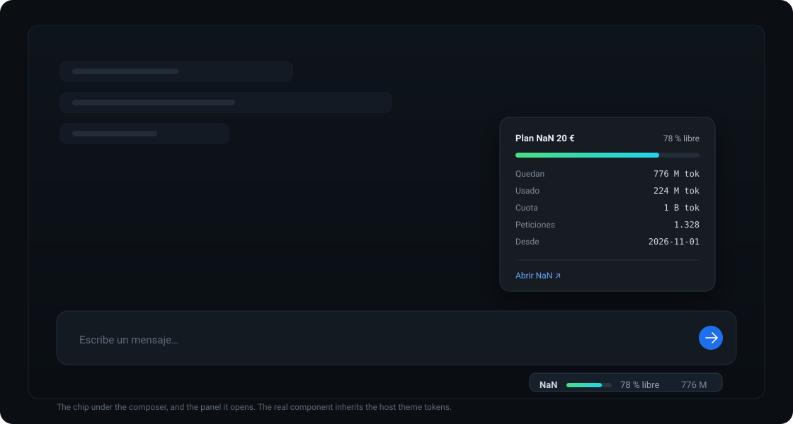
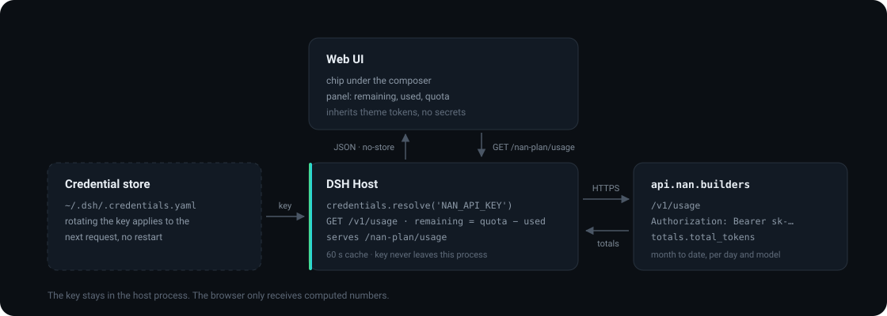

# dsh-nan-plan

Plugin de [DeepSeek Harness](https://github.com/deepseek-ai) que muestra cuánto queda de tu plan de inferencia **NaN**, bajo el compositor del chat.



## Qué obtienes

- **Una píldora de una línea** bajo el compositor: `NaN ▓▓▓░ 78 % libre 776 M`.
- **Panel de detalle al pulsar**: quedan, usado, cuota, número de peticiones, desde qué día se cuenta, desglose por modelo cuando hay más de uno, y un enlace a NaN.
- **Sin credenciales en el navegador**: el host resuelve `NAN_API_KEY` del almacén del harness, consulta la API y sirve solo los números por una ruta propia.
- **Con el tema del host**: hereda colores y tipografía, así que se lee igual en claro y oscuro.

## Instalación

```
Plugins → Add plugin → dsh-nan-plan → Install → Enable now
```

o desde la terminal:

```bash
dsh plugin --profile <perfil> add dsh-nan-plan
```

También está en el [índice comunitario de DSH](https://github.com/enderdev01/dsh-plugins): añade esa fuente en **Plugins → Discover** y se instala desde ahí.

## Configuración

En la fila del bundle, en el `cordis.patch.yml` de tu perfil:

```yaml
- id: nan-plan
  name: 'dsh-nan-plan'
  config:
    plan: '20'
```

| Campo | Por defecto | Qué hace |
|---|---|---|
| `plan` | `'20'` | Tramo: `'20'`, `'75'` o `'200'`; fija cuota y etiqueta |
| `quotaTokens` | según `plan` | Fuerza una cuota propia |
| `apiKeyRef` | `NAN_API_KEY` | Credencial a resolver |
| `baseUrl` | `https://api.nan.builders` | Origen de la API |
| `refreshMs` | `60000` | Caché del host entre lecturas |
| `planName` | según `plan` | Etiqueta mostrada |

| Plan | Cuota por periodo |
|---|---|
| `'20'` | 1 B tokens |
| `'75'` | 3 B tokens |
| `'200'` | 3 B tokens |

NaN no publica la cuota por API, así que son valores de configuración. Si un tramo cambia, edita `PLAN_PRESETS` en [`index.js`](index.js) o usa `quotaTokens`.

## Cómo funciona



1. El host resuelve la clave con `ctx.credentials.resolve('NAN_API_KEY')` en cada lectura, así que rotarla aplica sin reiniciar.
2. Llama a `GET https://api.nan.builders/v1/usage?start_date=<día 1 del mes>&end_date=<hoy>`.
3. `used = totals.total_tokens`; `remaining = max(cuota − used, 0)`.
4. Sirve el resultado en `/nan-plan/usage`, mismo origen, `no-store`. La interfaz lee esa ruta y repinta la píldora y el panel.

Nada se estima en el navegador: los números llegan ya calculados.

## Límites

- NaN expone **solo consumo**: ni cuota ni fecha de facturación. Por eso la ventana es el mes natural y el panel muestra desde qué día cuenta en lugar de inventar un corte.
- El consumo viene agregado por día, así que el tope de 400 M tokens / 4 h no se puede derivar.
- Si falta la clave o la API falla, la píldora muestra `sin datos` y el motivo en el panel.

## Desarrollo

```bash
node cli.mjs                 # imprime los números del mes en curso
node scripts/publish.mjs     # genera .publish/ (renombra el paquete a dsh-nan-plan)
```

## Licencia

MIT
