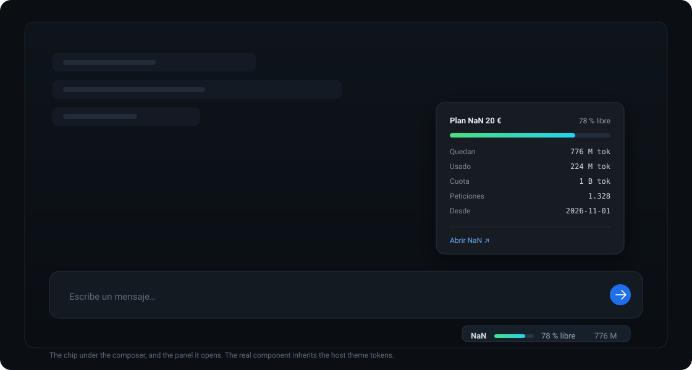
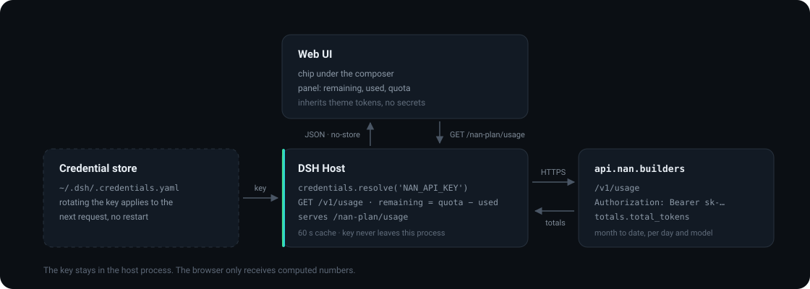

# dsh-nan-plan

A [DeepSeek Harness](https://github.com/deepseek-ai) plugin that shows how much of your **NaN** inference plan is left, right under the chat composer.



## What you get

- **A one-line chip** under the composer: `NaN ▓▓▓░ 78 % libre 776 M`.
- **A detail panel on click**: tokens left, used, quota, request count, the day the window opened, a per-model breakdown when the account uses more than one model, and a link to NaN.
- **No credentials in the browser.** The Host resolves `NAN_API_KEY` from the Harness credential store, calls the API, and serves only the computed numbers on its own route.
- **Theme-native.** The chip inherits the host's colors and type scale, so it reads the same in light and dark.

## Install

```
Plugins → Add plugin → dsh-nan-plan → Install → Enable now
```

or from a terminal:

```bash
dsh plugin --profile <profile> add dsh-nan-plan
```

It is also listed in the [DSH community index](https://github.com/enderdev01/dsh-plugins), so you can add that index source under **Plugins → Discover** and install it from there.

## Configuration

Set these on the bundle row in your profile's `cordis.patch.yml`:

```yaml
- id: nan-plan
  name: 'dsh-nan-plan'
  config:
    plan: '20'
```

| Field | Default | Meaning |
|---|---|---|
| `plan` | `'20'` | Plan tier: `'20'`, `'75'` or `'200'`; sets the quota and the label |
| `quotaTokens` | by `plan` | Overrides the preset quota |
| `apiKeyRef` | `NAN_API_KEY` | Credential reference to resolve |
| `baseUrl` | `https://api.nan.builders` | API origin |
| `refreshMs` | `60000` | Host-side cache between reads |
| `planName` | by `plan` | Label shown in the UI |

| Plan | Quota per period |
|---|---|
| `'20'` | 1 B tokens |
| `'75'` | 3 B tokens |
| `'200'` | 3 B tokens |

NaN does not publish the allowance through its API, so these numbers are configuration. If a tier changes, edit `PLAN_PRESETS` in [`index.js`](index.js) or set `quotaTokens`.

## How it works



1. The Host resolves the key with `ctx.credentials.resolve('NAN_API_KEY')` on every refresh, so a rotated key applies without a restart.
2. It calls `GET https://api.nan.builders/v1/usage?start_date=<first of month>&end_date=<today>`.
3. `used = totals.total_tokens`; `remaining = max(quota − used, 0)`.
4. It serves the result on `/nan-plan/usage`, same origin, `no-store`. The UI reads that route and re-renders the chip and panel.

Nothing is estimated in the browser: the numbers arrive already computed.

## Notes and limits

- NaN exposes **usage only** — no quota, no billing date. The window is therefore the calendar month, and the panel shows the day it opened instead of claiming a cutoff.
- Usage is aggregated per day, so the 400 M tokens / rolling 4 h cap cannot be derived.
- A missing key or a failing API shows `sin datos` in the chip and the reason in the panel.

## Development

```bash
node cli.mjs                 # print the numbers for the current month
node scripts/publish.mjs     # build .publish/ (renames the package to dsh-nan-plan)
```

## License

MIT
